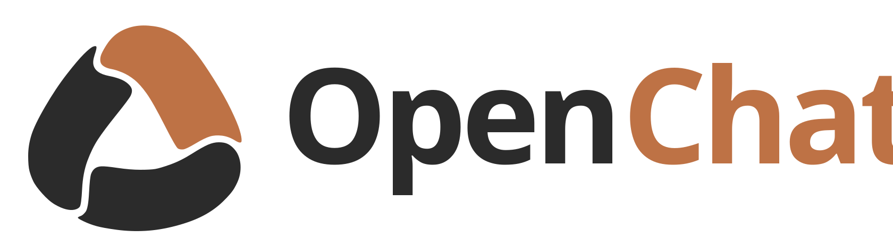
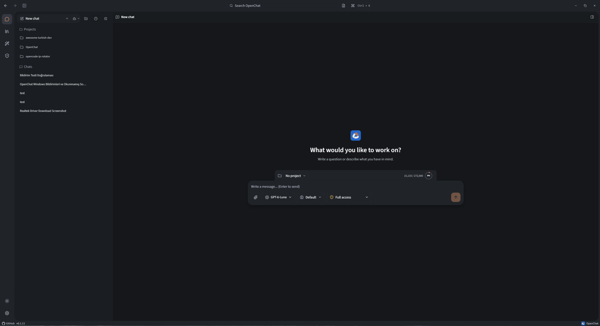
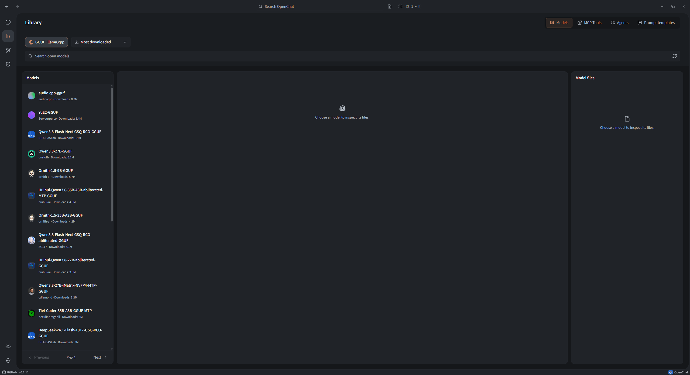
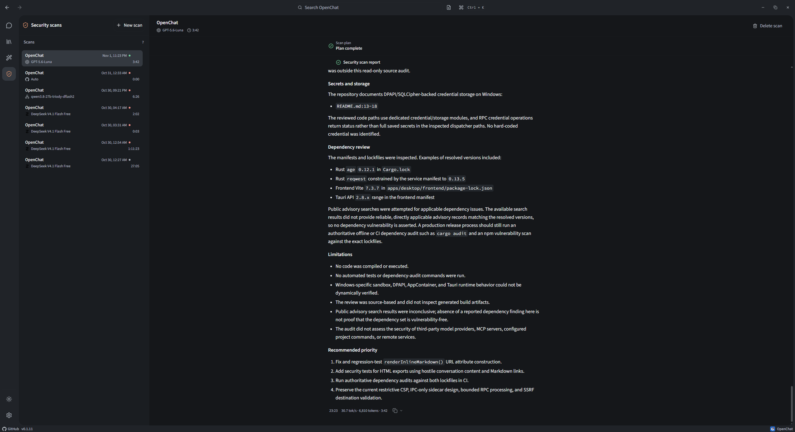
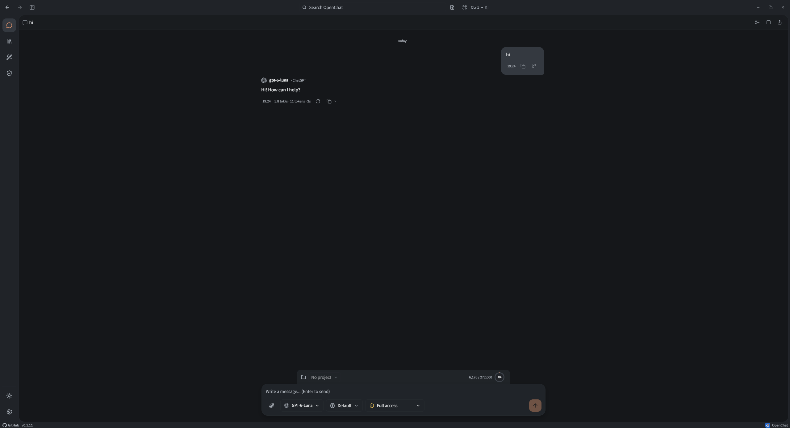

# OpenChat

<p align="center">
  
</p>

OpenChat is a local-first, privacy-focused desktop application designed for developers and technical workflows. It brings cloud AI providers, local inference runtimes, and isolated workspace tools together into a single, high-performance interface.

---

## Capabilities

### Unified Provider Support
Connect to multiple model ecosystems through standard, secure protocols:
- **Cloud Providers:** Direct integration with ChatGPT (OAuth), Anthropic Claude, Google Gemini, Mistral, DeepSeek, Groq, Cerebras, OpenRouter, Perplexity, xAI, Together AI, SambaNova, Fireworks AI, and Cohere, alongside custom OpenAI- and Anthropic-compatible endpoints.
- **Local Inference:** Built-in runtime management for `llama.cpp` supporting CPU and NVIDIA CUDA GPU acceleration, enabling offline GGUF model execution without external services.
- **Credential Storage:** On Windows, provider API keys, MCP secrets, and OAuth token pairs are DPAPI-protected in the SQLCipher database. Windows Credential Manager stores the database key and can contain legacy credential entries that OpenChat migrates into the protected vault. API keys entered in provider settings pass through the React renderer and Tauri IPC to the native host; credential-status commands return configuration state and redacted suffixes, not saved full keys.
- **Linux Credential Storage:** The encrypted profile key is stored in the user's Secret Service provider. Provider credentials are stored in the SQLCipher-encrypted database vault.

### Image Design Workspace
- **ChatGPT Image Generation:** Create images in the Design workspace with a ChatGPT OAuth account or an OpenAI API key. The chat `generate_image` tool uses the same generation service.
- **Image Library:** Browse images generated in Design and chat from one local library. Search and filter results, compare variants, reuse prompts, save prompt templates, and organize images with favorites, tags, and collections.
- **Generation Controls:** Configure supported model options such as dimensions, quality, background treatment, and API output format. ChatGPT OAuth image generation uses the account's normal ChatGPT quota; there is no separate image quota. OpenAI API limits apply to API-key generation requests.

### Workspace Tools and Sandboxing
Run development tasks safely through configurable permission boundaries:
- **Filesystem Operations:** Read, search, write, and patch files with side-by-side diff review and revert capability.
- **Process Isolation:**
  - **Windows AppContainer (Default):** Isolates local tool processes in approval and safe-operation modes with filesystem and network boundaries.
  - **WSL2 Container Sandbox (Opt-in):** Uses `bubblewrap` (`bwrap --unshare-all`) for local tool processes in approval and safe-operation modes.
  - **Full access:** Lets file tools use any absolute path allowed to the current account, and runs terminal commands, configured project tools, and project MCP servers used as chat tools without AppContainer or bubblewrap isolation. It does not elevate the process or bypass operating-system permissions. Global MCP catalog discovery remains sandboxed.
- **Trust Handoff Protection:** Sensitive repository paths, including `.git/hooks` and IDE configurations, require explicit confirmation (`Ask`) before modifications.
- **Live Data Loss Prevention (DLP):** Real-time secret and token masking (`[REDACTED]`) sanitizes terminal outputs, tool calls, and file reads to prevent credentials from entering model context.
- **Model Context Protocol (MCP):** Connect to local stdio and remote Streamable HTTP MCP servers with granular tool-level permissions on Windows and Linux. Linux local stdio servers use Bubblewrap isolation in approval and safe-operation modes, with no network access and write access limited to the project directory and sandbox `/tmp`. Full access runs them without Bubblewrap.

### Context Management and Retrieval
- **Hybrid Search Engine:** Combines full-text keyword indexing (SQLite FTS5) with local multilingual embeddings (ONNX) for semantic codebase recall.
- **Context Compaction:** Bounded summarization and checkpointing prevent context window overflow while preserving message history.
- **Projects and Skills:** Organize workspaces with project-specific instructions, declared tasks, and reusable skills (`SKILL.md`).

### Execution Modes
- **Plan Mode (`/plan`):** Instructs models to formulate detailed technical proposals before tools can be invoked.
- **Goal Mode (`/goal`):** Autonomous multi-turn workflow execution with real-time checklists, progress tracking, and interrupt recovery.

---

## Screenshots

<p align="center">
  
  
</p>
<p align="center">
  
  
</p>

## Getting Started

### Requirements
- Windows 10 or 11 (64-bit), or Linux x86_64 with WebKitGTK 4.1
- Linux requires a Secret Service provider on the user's D-Bus session for encrypted profile keys; Bubblewrap and unprivileged user namespaces are required for isolated terminal and local stdio MCP execution
- Microsoft Edge WebView2 Runtime 111.0.1661.0 or newer on Windows
- Node.js 22 and npm
- Rust 1.95 (pinned by `rust-toolchain.toml`)

### Building from Source

1. Clone the repository:
   ```bash
   git clone https://github.com/alztrk/openchat.git
   cd OpenChat
   ```

2. Install frontend dependencies and start development mode:
   ```bash
   npm ci
   cd apps/desktop/frontend
   npm run openchat -- dev
   ```

3. Run workspace validation:
   ```bash
   cd apps/desktop/frontend
   npm run openchat -- check
   ```

This check runs Biome, frontend unit tests, locale and import checks, the TypeScript/Vite asset build, Rust formatting, and locked Rust checks/tests. CI uses the same validation task for these checks.

### Packaging

To build a standalone package for the current operating system:
```bash
cd apps/desktop/frontend
npm run openchat -- build
```

On Windows, the installer uses Tauri’s default WebView2 download-bootstrapper mode. If the runtime is missing or older than 111.0.1661.0, installation attempts to download or update it and requires an internet connection. See [Tauri’s WebView2 installation options](https://v2.tauri.app/distribute/windows-installer/#webview2-installation-options). On Linux, the build creates Debian and AppImage packages; the Debian package declares Bubblewrap as a dependency.

---

---

## License

OpenChat is open-source software licensed under the [MIT License](LICENSE).
