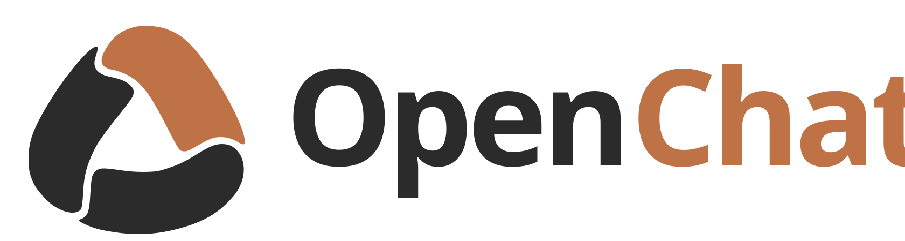

# OpenChat

<p align="center">
  
</p>

OpenChat is a local-first, privacy-focused desktop application designed for developers and technical workflows. It brings cloud AI providers, local inference runtimes, and isolated workspace tools together into a single, high-performance interface.

---

## Capabilities

### Unified Provider Support
Connect to multiple model ecosystems through standard, secure protocols:
- **Cloud Providers:** Direct integration with ChatGPT (OAuth), Anthropic Claude, Google Gemini, Mistral, DeepSeek, Groq, Cerebras, OpenRouter, Perplexity, xAI, Together AI, SambaNova, Fireworks AI, and Cohere, alongside custom OpenAI- and Anthropic-compatible endpoints.
- **Local Inference:** Built-in runtime management for `llama.cpp` supporting CPU and NVIDIA CUDA GPU acceleration, enabling offline GGUF model execution without external services.
- **Credential Storage:** Keys and tokens are kept in the operating system credential store (Windows Credential Manager / DPAPI). Credentials are never exposed to UI renderers or written to diagnostic logs.

### Workspace Tools and Sandboxing
Run development tasks safely through configurable permission boundaries:
- **Filesystem Operations:** Read, search, write, and patch files with side-by-side diff review and revert capability.
- **Process Isolation:**
  - **Windows AppContainer (Default):** Zero-configuration token isolation enforcing strict filesystem and network boundaries.
  - **WSL2 Container Sandbox (Opt-in):** Kernel-level isolation using `bubblewrap` (`bwrap --unshare-all`) inside WSL2.
- **Trust Handoff Protection:** Sensitive repository paths, including `.git/hooks` and IDE configurations, require explicit confirmation (`Ask`) before modifications.
- **Live Data Loss Prevention (DLP):** Real-time secret and token masking (`[REDACTED]`) sanitizes terminal outputs, tool calls, and file reads to prevent credentials from entering model context.
- **Model Context Protocol (MCP):** Connect to local stdio and remote Streamable HTTP MCP servers with granular tool-level permissions.

### Context Management and Retrieval
- **Hybrid Search Engine:** Combines full-text keyword indexing (SQLite FTS5) with local multilingual embeddings (ONNX) for semantic codebase recall.
- **Context Compaction:** Bounded summarization and checkpointing prevent context window overflow while preserving message history.
- **Projects and Skills:** Organize workspaces with project-specific instructions, declared tasks, and reusable skills (`SKILL.md`).

### Execution Modes
- **Plan Mode (`/plan`):** Instructs models to formulate detailed technical proposals before tools can be invoked.
- **Goal Mode (`/goal`):** Autonomous multi-turn workflow execution with real-time checklists, progress tracking, and interrupt recovery.

---

## Getting Started

### Requirements
- Windows 10 or 11 (64-bit)
- Node.js (v18+) and npm
- Rust stable toolchain

### Building from Source

1. Clone the repository:
   ```bash
   git clone https://github.com/your-org/OpenChat.git
   cd OpenChat
   ```

2. Compile the backend service:
   ```powershell
   cargo build --manifest-path services/openchat-service/Cargo.toml --release
   New-Item -ItemType Directory -Force apps/desktop/tauri/binaries
   Copy-Item -LiteralPath services/openchat-service/target/release/openchat_service.exe -Destination apps/desktop/tauri/binaries/openchat_service-x86_64-pc-windows-msvc.exe -Force
   ```

3. Install frontend dependencies and start development mode:
   ```bash
   cd apps/desktop/frontend
   npm install
   npm run tauri:dev
   ```

### Packaging

To build the standalone installer:
```bash
cd apps/desktop/frontend
npm run tauri:build
```

---

## Architecture Principles

- **Local-First Design:** Chat transcripts and vector stores reside in local SQLite databases under `%LOCALAPPDATA%\OpenChat`. No telemetry or personal information is transmitted to third parties.
- **Explicit Authorizations:** Three security tiers (`Ask for approval`, `Approve safe operations`, `Full access`) govern filesystem, network, and execution privileges.
- **Technical Documentation:** Detailed architecture contracts and design notes are available in [docs/architecture.md](docs/architecture.md) and [ROADMAP.md](ROADMAP.md).

---

## License

OpenChat is open-source software licensed under the [MIT License](LICENSE).
